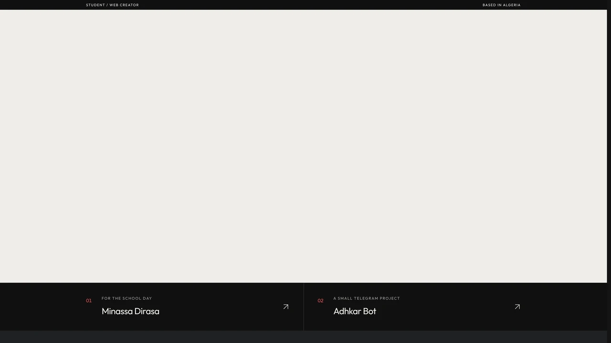
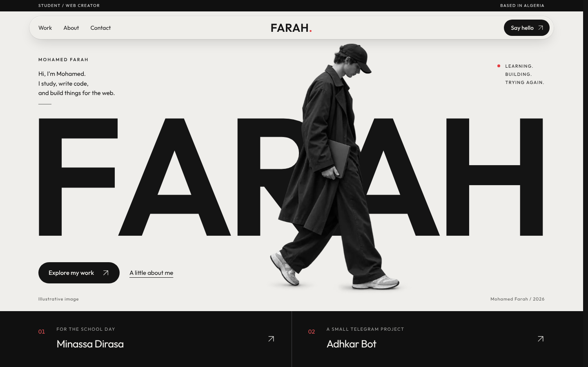
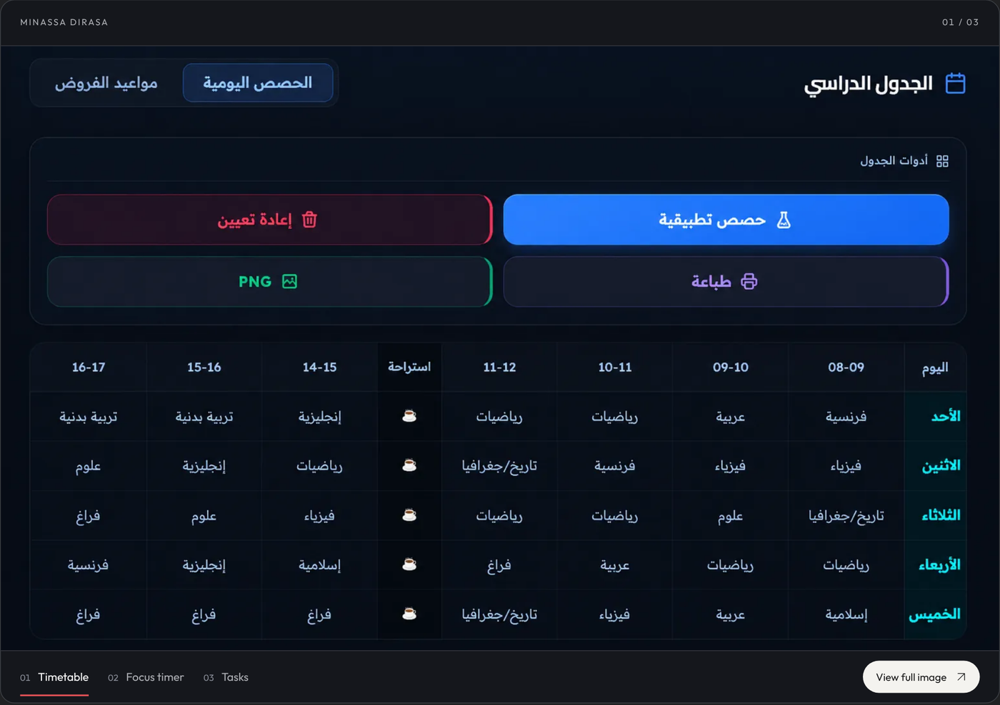
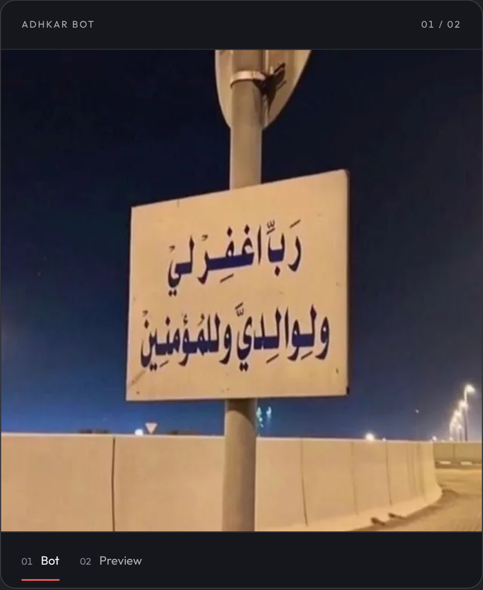
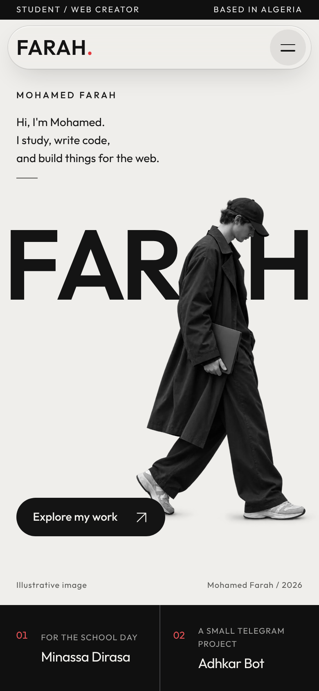

<div align="center">

<a href="https://farah-mohamed-site.vercel.app/"><b>View the live site</b></a>
&nbsp;&nbsp;·&nbsp;&nbsp;
<a href="#preview">Preview</a>
&nbsp;&nbsp;·&nbsp;&nbsp;
<a href="#run-it">Run it</a>
&nbsp;&nbsp;·&nbsp;&nbsp;
<a href="#copyright-and-license">License</a>

</div>

<br><br>


<br><br>

<div align="center">
  
</div>

<br>

<h2>&nbsp; About</h2>

I'm **Mohamed Farah**, a student from Algeria who writes code and builds things for the web. I made this portfolio, and the projects in it, on my own from scratch. I'm still learning, building and trying again.

<table>
<tr>
<td width="48" valign="top"></td>
<td><b><a href="https://minassa-dirasa.vercel.app/">Minassa Dirasa</a></b><br>A free Arabic study web app with a timetable, a Pomodoro timer, tasks, notes and grades.</td>
</tr>
<tr>
<td width="48" valign="top"></td>
<td><b>Adhkar Bot</b><br>A Telegram bot that posts the morning, evening and sleep adhkar and a Fajr reminder to your channel every day, at the times you choose.</td>
</tr>
</table>

<h2>&nbsp; What's inside</h2>

- **Scroll motion** with Lenis and GSAP: a word-by-word text reveal, sheet-style section transitions and images that zoom as you scroll.
- **Liquid-glass header** that changes tone with the section behind it.
- **Cinematic galleries** with layered image transitions and a matching lightbox.
- **Separate mobile behavior**: a full-width liquid call-to-action and tap-to-open images.
- **SEO ready**: Open Graph, Twitter cards, JSON-LD, sitemap and robots.
- **Accessible motion** that respects `prefers-reduced-motion` and `prefers-reduced-transparency`.
- **Fast by default**: no framework, no build step, WebP images in two sizes and zero layout shift.

<h2>&nbsp; Preview</h2>

<p align="center">
  
</p>
<p align="center">
  
</p>
<p align="center">
  
  &nbsp;&nbsp;
  
</p>

<h2>&nbsp; Tech stack</h2>

| Tool | Used for |
|---|---|
| HTML, CSS, vanilla JavaScript | Structure, design tokens and interaction |
| [Lenis](https://lenis.darkroom.engineering/) 1.3.26 | Smooth scrolling |
| [GSAP](https://gsap.com/) 3.12.5 and ScrollTrigger | Scroll-driven animation |
| [Outfit](https://fonts.google.com/specimen/Outfit) | Typeface, self-hosted |
| Vercel | Hosting, caching and security headers |

<h2>&nbsp; Run it</h2>

No install and no build.

```bash
git clone https://github.com/chemchoun123456789-bot/mohamed.git
cd mohamed
python3 -m http.server 8000
# open http://localhost:8000
```

To deploy, upload the folder root to any static host. On Vercel, `vercel.json` sets the headers. If you change the domain, update the URL in `index.html` (canonical, `og:url`, `og:image`, `twitter:image`, JSON-LD), `robots.txt` and `sitemap.xml`.

<h2>&nbsp; Structure</h2>

```text
index.html        content, structure, SEO tags
style.css         tokens, layout, motion
app.js            header, galleries, lightbox, scroll effects
assets/           WebP images, fonts, icons, vendor (Lenis, GSAP)
docs/             banner, screenshots, demo (README only)
LICENSE           attribution license
```

<h2>&nbsp; Copyright and license</h2>

**Copyright 2026 Mohamed Farah. All rights reserved**, except what the [attribution license](LICENSE) allows.

> [!IMPORTANT]
> **Using this design? Credit is required.** You may reuse the code and layout, but changing the name, colors or text does not remove the credit. If you publish a site based on this one, you must:
>
> 1. Keep the [LICENSE](LICENSE) and the copyright line.
> 2. Write **"Design and code by Mohamed Farah"** with a **link to this repository** ([chemchoun123456789-bot/mohamed](https://github.com/chemchoun123456789-bot/mohamed)) in your README and in your site's footer.
> 3. Say clearly that your site is based on this one. Do not present it as entirely your own work.

Not included, and not for reuse: my name, texts, the hero illustration, every image in `assets/` and `docs/`, and the Minassa Dirasa and Adhkar Bot screenshots.

Found a copy without credit? Open an issue on this repository or write to me through the [site](https://farah-mohamed-site.vercel.app/).

Third-party: Outfit (SIL OFL 1.1), Lenis (MIT), GSAP and ScrollTrigger (GSAP Standard License). Their licenses are in `assets/`.

<div align="center">
<br>
<sub>Made by Mohamed Farah · Algeria · 2026</sub>
</div>
